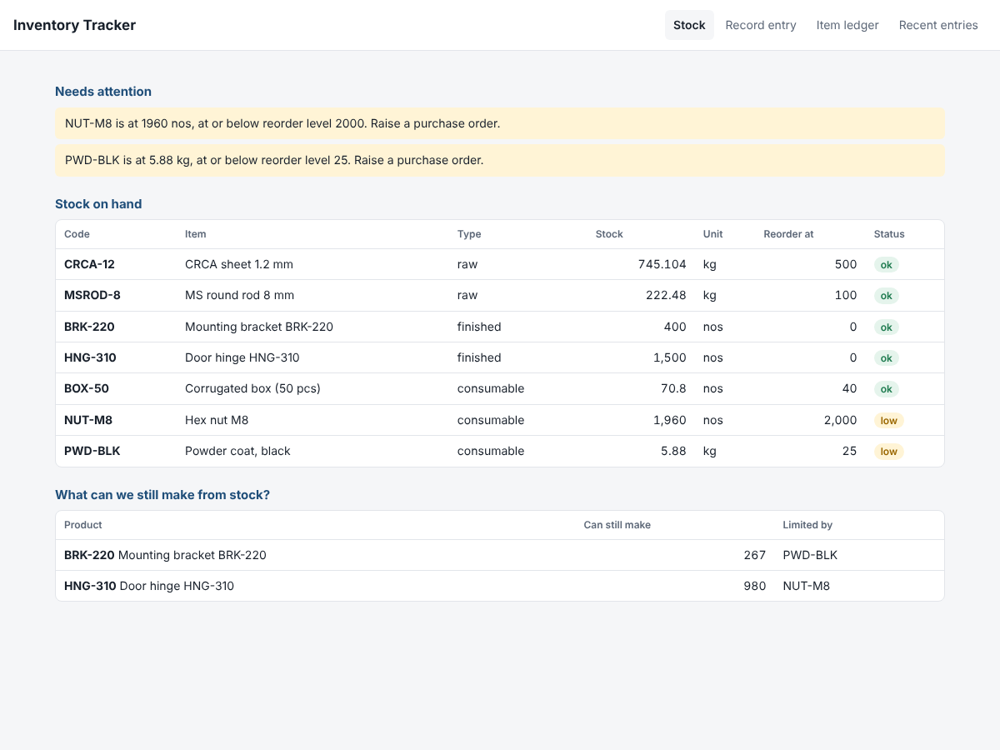
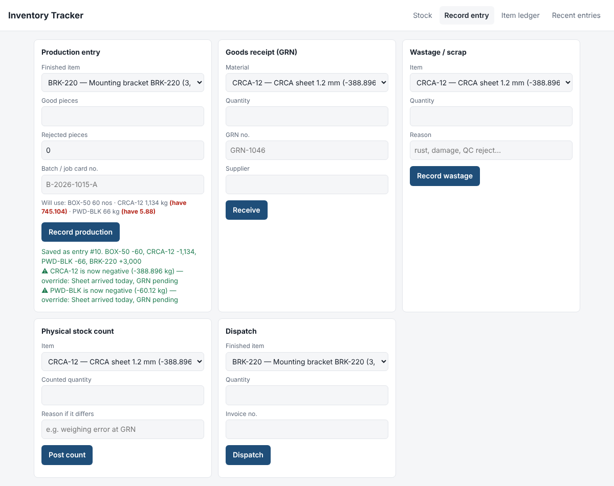

# Inventory Tracker

A raw material and finished goods tracker for a small manufacturer, built around one idea: **when the supervisor records production, the raw material should go down by itself.**

In most small plants, the store keeper keeps a stock register, the supervisor keeps a production register, and nobody can say how much sheet metal is actually left until someone walks to the rack. This app links the two through a bill of materials (BOM), keeps every stock change as an entry you can trace, and is strict about the exceptions that cause stock to drift.



## What it does

- **Production consumes material automatically.** Record "2400 good, 60 rejected" and the BOM works out the sheet, powder coat and boxes used — including process scrap (e.g. 8% offcuts), and including the rejected pieces, because they used material too.
- **Shows what you can still make.** For each product: how many more units the stock on hand allows, and which material runs out first.
- **Low stock alerts** against a reorder level per item.
- **A full ledger per item** with running balance — every receipt, production, wastage, count and dispatch.
- **Preview before you save.** The production form shows how much material the entry will use and highlights what you don't have.



## The exceptions, and how it handles them

These are the cases that make a stock register wrong. Each is a deliberate rule, and each has a test.

| Situation on the floor | Rule |
|---|---|
| Production logged but the material's GRN hasn't been entered yet | Blocked with the exact shortfall ("CRCA-12 short by 388.9 kg"). The supervisor can record it anyway **with a reason**; stock goes negative and stays on the alert list until the GRN is entered. Production is never lost, and the gap is never hidden. |
| Same GRN slip or batch card entered twice | Rejected (case- and space-insensitive), pointing to the original entry |
| Someone entered the wrong quantity | Nothing is edited or deleted. The entry is **reversed** as a whole (all its movements), with a reason; the history keeps both. A reversal can't be reversed twice. |
| Reversing a GRN whose material was already used | Blocked, because stock would go negative — needs an override reason |
| Physical stock count doesn't match the system | The difference is posted as an adjustment with a required reason; stock is never just overwritten |
| Wastage (rust, handling damage) | Needs a reason; can't waste more than you have |
| Dispatch more finished goods than in stock | Blocked, **no override** — you can't ship what isn't there |
| Producing an item that has no BOM yet | Refused, with a clear message, instead of silently consuming nothing |
| Floating-point drift (0.1 + 0.1 + 0.1 ≠ 0.3) | Quantities are rounded to 3 decimals (grams / mm) so there's no phantom 0.0000001 kg |

## Run it

```bash
pip install -r requirements.txt
python -m inventory.seed                  # loads a small fictional sheet-metal plant
uvicorn inventory.api:app --reload        # open http://127.0.0.1:8000
python -m pytest -q                       # 30 tests
```

API docs are at `/docs`. Main endpoints:

| | |
|---|---|
| `GET /api/stock` | stock, what-can-we-build, alerts |
| `POST /api/receipts` | goods receipt (GRN) |
| `POST /api/production` | production entry (`override_reason` to force through a shortage) |
| `POST /api/wastage`, `POST /api/dispatch`, `POST /api/stock-count` | |
| `POST /api/txns/{id}/reverse` | reverse a whole entry |
| `GET /api/items/{code}/ledger` | item history with running balance |
| `GET /api/items/{code}/required?units=500` | material a production run will use |

## Design

```
inventory/
  db.py         SQLite schema: items, bom, txns, movements
  services.py   all the business rules (no HTTP in here, so they're easy to test)
  api.py        FastAPI routes; errors come back as {"error": "...", "shortages": [...]}
  seed.py       sample plant
  static/index.html   single-page UI, no build step
```

Stock is **never stored** — it's the sum of the movements. Each user action is one transaction with one or more movements, written atomically, so a production entry can't half-consume material. This is the same idea as an accounting ledger, and it's what makes reversals and the audit trail simple.

## Open questions for a real customer

- Do they buy in one unit and consume in another (sheets bought by the ton, issued by the sheet)? That needs unit conversions on items.
- Is material issued to the floor in advance (store → line), or consumed at production entry? Many plants do the first, and then "line stock" is its own location.
- Who is allowed to use the override, and should the owner get a message when they do?
- Batch / heat number traceability, if their customers (often auto OEMs) ask for it.

## How this was built

Built with Claude (Anthropic) as an AI coding agent. The behaviour for each exception is written down above and covered by tests, so it can be reviewed and changed.
